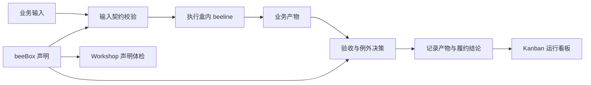

# beeOS

> Business Fulfillment Operating System — 业务履约操作系统

beeOS 用明确的输入、业务结果、验收标准和例外规则，把一项业务责任组织成可运行、可核对的 **beeBox（业务履约盒子）**。
每次运行留下产物、执行轨迹与验收结论，供业务负责人和开发者检查交付是否成立。

**当前处于早期开发阶段**，适合本地体验、业务建模和集成验证。生产采用前请阅读[成熟度与限制](#成熟度与限制)。

[快速开始](#快速开始) · [运行示例](#运行示例) · [业务场景](#业务场景) · [文档](#文档导航) · [许可证](#许可证)

## 为什么使用 beeOS

当一个业务任务需要串联模型、程序和人工决策时，团队需要共同约定：输入是否合格、交付什么、怎样验收、异常由谁接手。
beeOS 把这些约定写进盒子的声明，并在执行前后检查。

| 业务问题 | beeOS 中的实现 |
|---|---|
| 什么输入可以开始处理？ | Schema 与输入契约校验 |
| 应该交付什么、怎么算合格？ | Result 与 Acceptance 验收规则 |
| 每次任务经过了哪些步骤？ | beeline 作业路线与 operation 执行轨迹 |
| 出错后拒绝、等待人工还是重试？ | 例外条款、Queen 决策与运行状态 |
| 上下游怎样交接？ | 域声明与产物引用校验 |
| 怎样检查声明和查看运行结果？ | Workshop 体检台与 Kanban 看板 |

业务实现放在盒子内，运行时负责执行与验收机制。适合希望把业务规则、AI 调用和交付证据放在同一套契约下维护的开发团队。

## 快速开始

需要 **Python 3.11+**、Git 和可访问依赖源的网络。以下为 macOS / Linux 的 Bash 命令，请在同一终端执行。

```bash
git clone https://github.com/Generic-Technology/beeOS.git
cd beeOS
python3.11 -m venv .venv
source .venv/bin/activate
python -m pip install --upgrade pip
python -m pip install -e '.[dev]'
python -m kanban.web
```

如使用更高版本 Python，请将 `python3.11` 替换为对应解释器命令。
打开 [Kanban 看板](http://localhost:8765) 查看盒子与运行记录；打开 [Workshop 体检台](http://localhost:8765/workshop) 检查声明。
新安装尚无履约历史，可在下方示例运行后刷新看板。停止服务使用 `Ctrl+C`；端口被占用时可用 `python -m kanban.web --port 8766`。

启动页面和下方手工输入示例**不需要模型密钥**。自然语言抽取、WMS 概念绑定、照片识别等能力需要 LLM，见[模型配置](#模型配置)。

## 运行示例

在另一个终端进入仓库并激活 `.venv`，运行以下命令。它把一次数学练习整理为带出处的学习事件，检查得分率，并将本次运行写入本地记录。

```bash
source .venv/bin/activate
python - <<'PY'
from kanban.trigger import trigger_task
from runtime.store import TaskRunStore

run = trigger_task(
    box_id="learning_math_box",
    task_type="run_math",
    payload={
        "activity": "数学单元练习",
        "observed_at": "2026-11-06T16:30:00+08:00",
        "evidence": "示例练习卷 P1（演示数据）",
        "source_kind": "reported",
        "score": 18,
        "total": 20,
    },
    store=TaskRunStore(path="logs/task_runs.jsonl"),
)
print("status:", run["status"])
print("acceptance:", run["acceptance_status"])
print("mastery:", run["result"]["mastery"])
PY
```

预期输出：

```text
status: completed
acceptance: accepted
mastery: 0.9
```

这里的 `mastery` 是本次得分率（18 ÷ 20），用于演示可复算的验收规则。它不代表对学习能力的评价。
运行记录写入 `logs/task_runs.jsonl`；这是显式标注的演示数据，请在独立的本地环境体验。
查看输入和产出定义：[数学盒说明](boxes/learning_math/README.md)。

## 业务场景

| 场景 | 当前仓库内容 | 入口 |
|---|---|---|
| WMS 软件履约 | 需求捕获、仓储设计、代码生成、场景验证、运维核对、效果分析与系统档案 | [需求盒](boxes/wms_requirement/README.md)、[闭环实测记录](docs/wms-closure-plan.md) |
| 小票识别 | 从图片生成结构化小票，并检查金额等业务约束 | [小票盒](boxes/receipt/README.md) |
| 学习记录 | 数学、语文、英语事件与成长档案，保留记录出处 | [数学](boxes/learning_math/README.md)、[语文](boxes/learning_chinese/README.md)、[英语](boxes/learning_english/README.md)、[成长档案](boxes/learning_growth/README.md) |

WMS 域已定义并串联如下履约链，各阶段产物同时汇入系统档案盒：

```text
需求捕获 → 仓储设计 → 代码生成 → 场景验证 → 运维核对 → 效果分析
   ↑                                                     │
   └──────────────── 下一轮需求种子 ──────────────────────┘
```

完整链路需要模型服务及相应的 WMS 项目、构建和目标环境配置。上述本地示例只验证单盒闭环。
各盒子的验收规则与声明成熟度见页尾[仓库参考](#仓库参考)，运行时体检结论可在 Workshop 查看。

## 架构概览

**beeOS 提供基础设施，beeBox 承接业务责任，TaskRun 记录一次履约。**
每个盒子包含输入与结果定义、作业路线、处理实现、验收和例外规则；域声明描述盒子之间的关系。



| 位置 | 职责 |
|---|---|
| `core/` | 数据模型、契约与声明校验、装配 |
| `boxes/` | 业务定义、处理实现与指标计算 |
| `domains/` | 域成员、交接与反馈关系 |
| `runtime/` | 执行、验收、恢复与持久化 |
| `kanban/` / `workshop/` | 运行观察与声明体检 |

## 成熟度与限制

当前 Python 项目版本为 `0.1.0`，接口与声明仍在演进。盒子声明中的 `live` 是项目内部的成熟度标记，不代表生产认证或 SLA 承诺。

- **可本地验证**：契约校验、盒内执行、验收、人工等待与恢复、盒间交接、JSONL 记录、CLI / Web 看板和只读体检台。
- **生产接入仍需补齐**：Web 看板尚无认证；任务同步执行，本地 JSONL 存储尚不能替代分布式任务与数据基础设施。请仅在可信本地环境启动体验服务。
- **尚未完成**：补偿反向操作、独立发布与版本实体、第三方盒子安装与隔离、盒子市场及商业认证体系。
- **业务验证边界**：WMS 的部分运营指标尚无真实生产流量可验证，链路运行成功与验收通过不能作为商业收益证明。详见[闭环实测记录](docs/wms-closure-plan.md)。

后续工程加固顺序与验收标准见[稳定性计划](docs/stability-plan.md)。商业产品方向见 [GTM 草稿](docs/beeos-gtm.md)，其中规划内容以本页的实现边界为准。

## 模型配置

调用模型前，在启动 beeOS 的终端设置以下环境变量，再启动服务：

```bash
export BEEOS_LLM_API_KEY='<你的真实密钥>'
export BEEOS_LLM_BASE_URL='https://api.minimaxi.com/v1'
python -m kanban.web
```

当前调用默认使用 MiniMax 模型。端点、默认模型与协议细节以 [LLM 客户端](runtime/llm.py) 为准，替换服务时需核对兼容性。
模型调用会把相关业务文本或图片发送给配置的服务，并产生该服务的调用费用。

环境变量样板见 [`.env.example`](.env.example)。直接使用 `.env` 需要额外安装 `python-dotenv`；上面的 `export` 方式不依赖它。
样板还保留了部分早期规划配置，不代表相应基础设施已经实现。

## 文档导航

| 想了解什么 | 文档 |
|---|---|
| 概念与契约 | [beeBox 设计](docs/beebox-design.md)、[Definition Schema](docs/beebox-definition-schema.md) |
| 作业路线与执行 | [beeline](docs/beeline.md)、[运行时说明](runtime/README.md) |
| 盒子装配与域关系 | [脚手架协议](docs/architecture-upgrade.md)、[域声明](docs/domain-declaration.md) |
| 观察任务与检查声明 | [Kanban](kanban/README.md)、[Workshop](workshop/README.md) |
| WMS 链路的验证依据 | [闭环计划与实测记录](docs/wms-closure-plan.md) |
| 产品与商业方向 | [GTM 草稿](docs/beeos-gtm.md) |

设计稿包含未来形态；实现状态以本页、对应代码和可复现的检查结果为准。

## 开发与参与

完成上面的开发依赖安装后，在仓库根目录运行：

```bash
python -m pytest tests/ -q
python -m kanban.cli
python scripts/new_box.py --help
```

测试中的 LLM 桩用于隔离外部服务，测试通过不等于真实模型与生产环境已经验证。
欢迎通过 [GitHub Issues](https://github.com/Generic-Technology/beeOS/issues) 报告问题、讨论场景和提出合作需求，通过 Pull Request 提交改进。
报告问题时请附复现步骤、Python 版本与必要的脱敏日志；不要公开密钥或业务隐私数据。

## 商业使用与合作

本仓库代码采用 MIT 许可证，可用于商业项目。行业盒子定制、系统集成或商业支持需求可先通过 [GitHub Issues](https://github.com/Generic-Technology/beeOS/issues) 联系维护者。
当前仓库没有公布付费套餐、托管服务或支持 SLA；交付范围与服务承诺需另行约定。

## 许可证

采用 [MIT License](LICENSE)。使用、修改与分发时请遵守许可证要求，保留版权与许可声明；软件按现状提供。
第三方依赖和随附资源还需遵守各自的许可，外部模型服务按其服务条款使用。

## 仓库参考

<details>
<summary>展开文件导航与盒子声明清单</summary>

以下为维护者导航。判据数量与成熟度来自盒子声明，实际运行质量需结合验收证据判断。

- **`docs/`** — 规格、设计稿与加固计划
  - `architecture-upgrade.md` — **盒子脚手架化**的定稿：协议 / 校验清单 / 迁移计划
  - `domain-declaration.md` — **域声明**设计与实现边界：盒子之间关系的唯一事实源
  - `stability-plan.md` — 按 SOLID 分批加固组件的顺序与验收标准
  - `beebox-design.md` — 主设计稿（架构宣言 / 核心契约 / 执行语义 / 实现设计）
  - `beebox-definition-schema.md` — beeBox Definition 数据形状
  - `beebox-beeline-schema.md` — beeline / Operation 数据形状
  - `beebox-runtime-design.md` — Runtime 设计
  - `beebox-runtime-schema.md` — Runtime 数据形状
  - `beeline.md` — beeline 是什么、为什么住在盒子里
  - `beeos-gtm.md` — 商业定位 / Catalog / Certification / 飞轮
  - `wms-closure-plan.md` — WMS 域「一个需求走完全链」的补齐计划与实测记录
  - `examples/order-exception-box.md` — 订单异常履约盒完整示例

- **`core/`** — 基础设施内核（只有数据结构，不含业务语义）
  - `__init__.py` — 内核包入口（一行 docstring 声明边界）
  - `models.py` — Definition / Schema / Field / Task / Result / Acceptance /
    Exception / Queen / Metrics 顶层数据结构（pydantic）
  - `beeline_models.py` — beeline / Operation / NextRef / Idempotency / Bee /
    ExternalSystem（含 DAG 校验）
  - `metrics.py` — 指标计算契约
  - `conditions.py` — 例外条件语法的**唯一真源**（runtime 从这里取，不另写一份）
  - `decl_checks.py` — 声明自洽判定的**唯一真源**（装配器与体检台共用一份）
  - `scaffold.py` — 装配器：按协议组装盒子，声明自相矛盾时**装配期就报错**
  - `contract.py` — 「什么类型算兼容」的**唯一真源**（声明层兼容判定与运行时产物校验共用一份）
  - `domain.py` — 域装配器：把域声明装成产物，域级声明不合法时**装配期就报错**
  - `wiring.py` — 接线投影：从**域声明**派生出域的接线图（纯函数，不拥有事实）

- **`domains/`** — 域声明（盒子之间关系的**唯一事实源**）
  - `__init__.py` — 域注册表（**显式注册，不扫目录**）+ 编排层读边的入口
  - `wms/domain.py` — WMS 域的声明：成员 + 边（按 `kind` 分三类）+ 域级规则
  - `learning/domain.py` — 学习域的声明（放射形状，规则与 WMS 不同）

- **`boxes/`** — 业务履约盒子（产品层）。**全部已注册**（清单见下表）
  - 每只盒子：`__init__.py` / `schemas.py` / `definition.py` / `runner.py`
    / `measure.py` / `beeline.py` / `README.md`

  **beeline 住在盒子里**（`boxes/<box>/beeline.py`），因为它跟盒子是 1:1
  且不可分割：它引用的 schema id 全部来自本盒的 `schemas.py`，每个 op 的
  handler 都在本盒的 `runner.py` 里。顶层一个独立的 beeline 目录只会让人
  以为存在一种可复用的跨盒路线，实际上一条都没有。
  路线细节见 [`docs/beeline.md`](docs/beeline.md)。

  | 目录 | box_id | 域 | 判据 | 例外 | 状态 |
  |---|---|---|---|---|---|
  | [`wms_requirement/`](boxes/wms_requirement/README.md) | `wms_requirement_box` | WMS | 4 | 2 | live |
  | [`wms_design/`](boxes/wms_design/README.md) | `wms_design_box` | WMS | 8 | 5 | live |
  | [`wms_development/`](boxes/wms_development/README.md) | `wms_development_box` | WMS | 4 | 2 | live |
  | [`wms_testing/`](boxes/wms_testing/README.md) | `wms_testing_box` | WMS | 6 | 2 | live |
  | [`wms_ops/`](boxes/wms_ops/README.md) | `wms_ops_box` | WMS | 5 | 2 | live |
  | [`wms_analysis/`](boxes/wms_analysis/README.md) | `wms_analysis_box` | WMS | 4 | 2 | live |
  | [`wms_system/`](boxes/wms_system/README.md) | `wms_system_box` | WMS | 5 | 3 | live |
  | [`receipt/`](boxes/receipt/README.md) | `receipt_capture_box` | 未归域 | 6 | 2 | live |
  | [`learning_math/`](boxes/learning_math/README.md) | `learning_math_box` | Learning | 3 | 2 | live |
  | [`learning_chinese/`](boxes/learning_chinese/README.md) | `learning_chinese_box` | Learning | 3 | 2 | live |
  | [`learning_english/`](boxes/learning_english/README.md) | `learning_english_box` | Learning | 3 | 2 | live |
  | [`learning_growth/`](boxes/learning_growth/README.md) | `learning_growth_box` | Learning | 4 | 2 | live |

- **`runtime/`** — 执行运行时（**不含任何业务知识**）
  - `__init__.py` — 运行时公开面（`create_task_run` / `BeelineExecutor` / `evaluate_acceptance`）
  - `models.py` — TaskRun durable object + 9 状态机 + Acceptance 4 状态
  - `executor.py` — BeelineExecutor（顺序 / 分支 + when 评估）
  - `runner.py` — HandlerRunner：按 `op.type` 找到该跑的 handler（纯机制）
  - `contract.py` — 投料结构契约闸（履约前第一道闸）
  - `handoff.py` — 盒间接力：把上游产出接到下游投料的 `ref:` 字段上
  - `acceptance.py` — Acceptance 评估器（4 状态转移）
  - `queen.py` — Queen escalation hook
  - `resume.py` — 「等外部」的履约怎么回来（转人工后由人接回去）
  - `images.py` — 图片格式归一（HEIC → JPEG，模型接口才收得下）
  - `store.py` — TaskRunStore（JSONL 持久化 + 查询）
  - `box_health.py` — 盒子体检台：接受声明作为入参，出每条检查的结论（三态）
  - `llm.py` — LLM 客户端（只管传输与解析，业务提示词由调用方给）
  - `README.md` — 运行时内部机制说明（状态机 / 恢复 / Queen 边界）

- **`kanban/`** — 运行面板（CLI + Web + task 投料口）
  - `cli.py` — CLI 看板（`python -m kanban.cli`）
  - `web.py` — Web 看板（`python -m kanban.web`，HTTP server + HTML + JS）
  - `trigger.py` — 投料口（`BOX_REGISTRY` + `trigger_task`：校验 → 执行 → 验收 → 落盘）
  - `catalog.py` — 把注册表里的材料攒成「一只盒子」（体检台的数据源）

- **`workshop/`** — BeeBox Workshop：做 BeeBox 的工作台（与 `kanban/` 平级，
  同一个服务、同一个端口，路径 `/workshop`）。第一版只做**体检台**：
  把一只盒子声明得对不对摊开给人看，只读。
  - `__init__.py` — 工作台包入口
  - `views.py` — 体检台页面 + 体检数据（判定在 `runtime/box_health.py`，
    守卫和页面读同一份）
  - `README.md` — 工作台说明（它和看板的区别 / 三态 / 现在没有什么）

- **`scripts/`** — 部署与校验
  - `deploy.sh` — 部署上线（同步 → 重启服务 → 线上自检）
  - `run_chain.py` — 端到端串跑多只盒子
  - `new_box.py` — 造一只合规的新盒子（接新域只写业务，不写样板）
  - `_sync_release.py` — 把**提交树**同步到服务器（不带工作区在途改动）
  - `verify_mermaid.py` — 文档里的 mermaid 块渲染校验
  - `standardization_audit.py` — 标准化审计

- **`tests/`** — 守卫（千条量级，以守卫为主）
  - 通用契约：`test_definition.py` / `test_beeline.py` / `test_runtime.py` /
    `test_runtime_reliability.py` / `test_taskrun_states.py` /
    `test_box_standard.py` / `test_box_refs.py` / `test_box_naming.py` /
    `test_layering.py` / `test_intake_contract.py` / `test_metrics.py` /
    `test_wiring.py` / `test_scaffold.py`（装配器协议的守卫）/
    `test_domain_declaration.py`（域声明的守卫）/
    `test_new_box_scaffold.py` / `test_subject_ref.py` /
    `test_work_item_attribution.py` / `test_op_trail.py` /
    `test_trail_matches_beeline.py` / `test_chain_script.py` /
    `test_queen_decision.py` / `test_stub_isolation.py` /
    `test_llm_structurer.py` / `test_migration_duplicate_table.py` /
    `test_migration_version_allocation.py`
  - 看板：`test_kanban.py` / `test_web_kanban.py` / `test_task_panel.py` /
    `test_frontend_delivery.py`
  - 盒子：`test_receipt_box.py` / `test_receipt_corpus.py` /
    `test_wms_requirement_box.py` / `test_wms_requirement_extraction.py` /
    `test_requirement_document.py` / `test_wms_design_box.py` /
    `test_wms_design_binder.py` / `test_wms_design_expectations.py` /
    `test_wms_development_box.py` / `test_wms_testing_box.py` /
    `test_wms_ops_box.py` / `test_wms_analysis_box.py` / `test_wms_system_box.py` /
    `test_learning_boxes.py` / `test_learning_photo.py`
  - 部署与文档：`test_docs_match_code.py`（本文档引用的每个路径都真实存在）/
    `test_sync_release.py` / `test_verify_deploy_readiness.py`

  > 这份清单是**导航**，不是契约——真实的条数以
  > `.venv/bin/python -m pytest tests/ -q` 报的为准。

</details>
