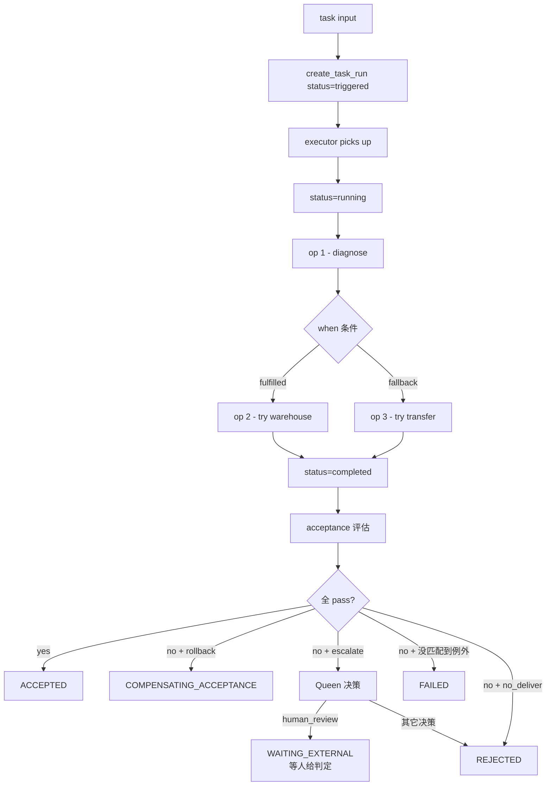

# runtime - 进程内 executor + TaskRun + Acceptance

> 按 [beebox-design.md §3.4] 实现的业务履约运行时。
> **业务语义是真的，基础设施可以是假的**——PoC 2 在进程内跑通完整 task run 闭环。

## 模块

```
runtime/
  __init__.py            # 统一导出
  models.py              # TaskRun durable object + 9 状态机 + Acceptance 4 状态
  executor.py            # BeelineExecutor（顺序 / 分支推进 + when 评估）
  runner.py              # HandlerRunner（按 op.type 找 handler，纯机制）
  contract.py            # 投料结构契约闸（履约前第一道闸）
  handoff.py             # 盒间接力：上游产出 → 下游 ref 字段
  acceptance.py          # Acceptance 评估器（4 状态转移）
  queen.py               # Queen escalation hook
  store.py               # TaskRunStore（JSONL 持久化 + 查询）
  llm.py                 # LLM 客户端（只管传输与解析）
```

**这个包不含任何业务知识。** handler 在各盒子的 `runner.py` 里，
runtime 只负责「按 `op.type` 找到该跑的 handler 并执行」。

## 流程



## TaskRun 9 状态机

| 状态 | 实现 | 含义 |
|---|---|---|
| `triggered` | ✅ | task run 创建，等待进入执行 |
| `running` | ✅ | 正在按 beeline 执行 operation |
| `retrying` | ✅ | 这一跳传输类失败，正在重试（只有 LLM 调用会重试；op 声明 `idempotency.mode=forbidden` 就不许重试；上限 3 次，每次都落盘）|
| `partially_completed` | ✅ | 链没走完，但**已经有 op 声明留下了产物/副作用**——东西留在现场，读者得知道「有残留」（终态）|
| `waiting_external` | ✅ | 等外部给个说法（人的判定）。`pending_external` 里记着**等谁、等什么、哪条判据没过** |
| `compensating` | ⏳ 未实现 | 触发补偿（等反向 op 的设计定下来，见 `docs/beebox-design.md` §3.4.4）|
| `rejected` | ✅ | 合同例外触发，**明确不交付**（终态）|
| `completed` | ✅ | beeline 走完 **且** 验收通过 = **交付了** |
| `failed` | ✅ | 没成，**且没人接**（判据没过又没有匹配的合同例外 / 重试耗尽 / op 失败且没有残留）|

### 状态之间谁能走到谁

转移白名单在 `runtime/models.py::ALLOWED_TRANSITIONS`，越界会抛错——不是静默改状态。

| 从 | 可以走到 |
|---|---|
| `triggered` | `running` / `failed` |
| `running` | `completed` / `failed` / `retrying` / `waiting_external` / `partially_completed` / `rejected` |
| `retrying` | `running`（重试同一跳）/ `failed` / `partially_completed` |
| `waiting_external` | `running` / `completed` / `rejected` / `failed` |
| `completed` | `failed` / `rejected` / `waiting_external`（**验收后的调整**：走完了 ≠ 交付了）|
| `partially_completed` / `rejected` | —（终态）|

### 履约层的终态 = 交付了没有

2026-11-01 定的口径（线上那条 `status=completed` + `acceptance=rejected` 的记录逼出来的）：
**判据在验收层，交付在履约层，履约层的终态就得说「交付了没有」**。

| 验收结果 | 履约层落到 | 为什么 |
|---|---|---|
| 通过 | `completed` | 交付了 |
| 不通过 + 例外 `no_deliver` | `rejected` | 合同说「不交付」——**明确的不交付**，不是「跑挂了」|
| 不通过 + 例外 `escalate` + queen 判 `human_review` | `waiting_external` | 要**等人给个说法** |
| 不通过 + 例外 `escalate` + 其它决策 | `rejected` | queen 接管了，但这次不交付 |
| 不通过 + 例外 `rollback` | 不动（保持 `completed`）| 补偿还没做（反向 op 设计未定）|
| 不通过 + **没匹配到例外** | `failed` | 没成，**没人接** |

「明确不交付」和「没人管」是两回事：前者有人做了决定，后者是没人接。
判据没过又没有合同例外说怎么办 → 就是 `failed`，别写成 `rejected`。

## Queen 决策层：升级 = 交给人

**Queen 的权力来自盒子自己的声明**，runtime 只做通用求值——runtime 不认识任何业务。

| 环节 | 谁说了算 | 规矩 |
|---|---|---|
| **什么时候升级** | **盒子** | 例外里写 `action="escalate"`（这只盒子的事）|
| **升级之后怎么办** | **Queen** | 在盒子声明的 `queen.rules.exception_handling.escalation_rules` 上求值 |
| **决策词** | **runtime**（唯一真源 `runtime/models.py`）| 只有三个：`human_review` / `auto_resolve` / `observe_only` |
| **盒子的 action → 决策词** | runtime 映射 | `escalate_to_human` → `human_review`；不认识的 action → `human_review` + 说清 |

**「升级」默认就是交给人**（2026-11-01 定的口径）：
没命中任何 Queen 规则时，决策是 `human_review`（停在 `waiting_external`），
不是 `auto_resolve`（直接拒掉）。
理由：**没人看的拒绝比多问一句更糟**——Queen 只能按盒子明说的降级，
不许自己决定「这事不用人看」。

以前这里写死了一个业务字段名（`refund_amount >`），
于是六只盒子声明的升级规则**一条都没被求值过**，
而全系统**一次都没传过** `queen_decision_fn` → `waiting_external` 一次都没走到过。

**决策可追溯**：Queen 每次决策都记进 `task_run.policy_decision`
（设计文档 §3.4.7），落盘在记录里：

```python
{"decision": "human_review", "reason": "规则「x > 1」命中（escalate_to_human）",
 "triggered_rule": "x > 1", "unusable_rules": ["y > 1（产出里没有「y」这个量）"]}
```

`unusable_rules` 是**用不上的规则**——条件指向一个产出里没有的量，
它永远不成立。**不许静默**：读者以为规则在守着，其实它一次都没触发过。

## Acceptance 4 状态机（独立阶段）

| 状态 | 含义 |
|---|---|
| `AWAITING_ACCEPTANCE` | task run COMPLETED 后进入，等验收判定 |
| `ACCEPTED` | 验收通过 → Business Fulfillment 成功 |
| `REJECTED` | 验收不通过 → Business Fulfillment 失败 |
| `COMPENSATING_ACCEPTANCE` | 触发补偿（执行反向 op 后回 AWAITING）|

## 端到端冒烟

```python
from boxes.wms_analysis import get_definition, get_beeline
from boxes.wms_analysis.runner import RUNNER
from runtime import (
    create_task_run, BeelineExecutor, evaluate_acceptance,
    default_queen_escalation_handler,
)

box = get_definition()
beeline = get_beeline()

# 1. 创建 task run
task_run = create_task_run(
    originator="analysis.api",
    intent="handle_effect_analysis_request",
    contract_ref=box.result.result_schema,
    release_id=f"{box.id}@v{box.version}",
    beeline_id=beeline.id, beeline_version=beeline.version,
    runtime_id="runtime_dev", instance_id="instance_local",
)

# 2. 执行 beeline（runner 由盒子自己提供，executor 不许猜）
executor = BeelineExecutor(RUNNER)
task_run = executor.execute(task_run, beeline, input_data)
# → status: triggered → running → completed

# 3. 跑 acceptance
eval_result = evaluate_acceptance(
    task_run, box.result,
    queen_decision_fn=lambda tr, failed: default_queen_escalation_handler(
        tr, failed, box.queen.rules.model_dump()
    ),
)
# → status: ACCEPTED / REJECTED / COMPENSATING_ACCEPTANCE
```

## op → handler 的映射在哪

**不在 runtime 里**。runtime 的 `runner.py` 只做「按 `op.type` 找 handler」这一件事，
handler 由各盒子自己提供（`boxes/<box>/runner.py`）。

例：效果分析盒的 3 个 op（`analysis_intake` / `analysis_compare` / `analysis_packager`）
全部实现在 `boxes/wms_analysis/runner.py`。

executor **不许自己猜 runner**——`BeelineExecutor(None)` 直接报错
（`requires a runner from the box`）。加盒子不用改内核，盒子也带得走自己的实现。

这条边界是硬边界：**runtime 里出现任何 WMS 词、票据词、需求词，就是越界了**
（`tests/test_layering.py` 盯着）。

## Queen 自治边界

PoC 2 实现 escalation decision hook：
- 触发场景：acceptance 失败 + exception.action=escalate
- 决策依据：`queen.rules.exception_handling.escalation_rules`
- 默认返回 `auto_resolve` 或 `queen.<action>`

Queen 不可改：contract / acceptance / release / policy（bounded autonomy）。

## PoC 2 时期暴露的真实问题（历史记录）

- 早期 mock runner 没填满所有 result 字段，导致 acceptance 大部分 rule fail
- acceptance rule 设计需要 executor 辅助填字段（如 `order_state_consistent`、`evidence_complete`）

这两条都已在「handler 归盒子、runtime 只做分派」的边界下解决：
字段填不满是盒子的责任，不是 runtime 的。